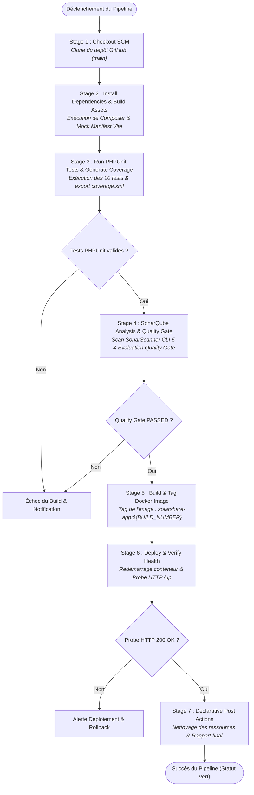
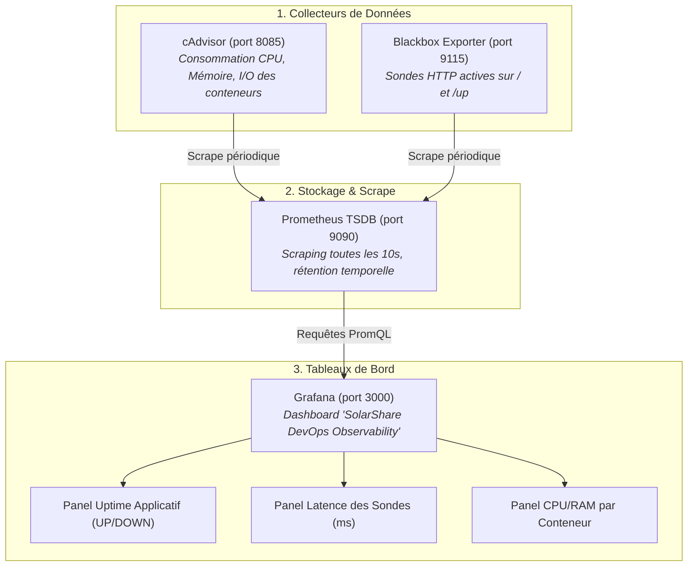

# Processus DevOps & Pipeline CI/CD — Projet SolarShare

> **Projet :** SolarShare (Plateforme d'énergie solaire communautaire)  
> **Technologies :** Laravel 12 (PHP 8.2), MySQL 8.0, Docker, Jenkins, SonarQube 9.9 LTS, Prometheus, Grafana  
> **Cadre :** ESPRIT — Module DevOps & Intégration Continue

---

## 1. Vue d'Ensemble du Processus DevOps

Le processus DevOps de SolarShare repose sur une boucle d'amélioration continue intégrant l'automatisation des tests, le contrôle qualité strict du code source, la conteneurisation des services et l'observabilité temps réel en production.

```mermaid
flowchart LR
    subgraph PlanCode ["1. Planification & Code"]
        A["Développeur (Branche Aziz)"] --> B["Git Commit & Push"]
        B --> C["Pull Request & Merge (main)"]
    end

    subgraph CI ["2. Intégration Continue (CI)"]
        C --> D["Jenkins Pipeline"]
        D --> E["Composer & Assets"]
        E --> F["Tests PHPUnit (90 tests)"]
        F --> G["SonarQube (Quality Gate)"]
    end

    subgraph CD ["3. Déploiement Continu (CD)"]
        G --> H["Build Image Docker"]
        H --> I["Déploiement Conteneur (App)"]
        I --> J["Sonde de Santé (HTTP 200 /up)"]
    end

    subgraph Monitor ["4. Observabilité & Exploitation"]
        J --> K["cAdvisor (CPU / RAM)"]
        J --> L["Blackbox (Latence HTTP)"]
        K & L --> M["Prometheus (Scraping TSDB)"]
        M --> N["Grafana (Dashboards)"]
    end

    N -.->|"Feedback métriques"| A
```

---

## 2. Diagramme Détaillé du Pipeline CI/CD Jenkins

Ce pipeline automatisé est orchestré par un **Jenkinsfile déclaratif** découpé en étapes séquentielles strictement validées :

---

## 3. Description Détaillée des Phases du Pipeline

### Phase A : Du Développement au Déclenchement (SCM)
1. **Développement Isolé :**  
   Les fonctionnalités et correctifs sont développés sur la branche fonctionnelle `Aziz`.
2. **Revue et Intégration :**  
   Le code est fusionné sur la branche `main` après validation.
3. **Déclenchement du Pipeline :**  
   Le serveur Jenkins interroge le dépôt GitHub distant et extrait le fichier déclaratif `Jenkinsfile`.

---

### Phase B : L'Intégration Continue (CI - Continuous Integration)

#### Étape 1 : Checkout SCM
* **Rôle :** Clone complet du code source sur l'espace de travail sécurisé de Jenkins (`/var/jenkins_home/workspace/SolarShare-Pipeline`).
* **Objectif :** Garantir que le build s'exécute exactement sur le commit validé.

#### Étape 2 : Installation des Dépendances & Préparation des Assets
* **Rôle :** Résolution et installation des paquets PHP via l'image conteneurisée officielle `composer:2`.
* **Particularité Laravel :** Génération automatique d'un manifeste Vite mocké (`public/build/manifest.json`) pour permettre le rendu des vues Blade sans exiger Node.js sur l'hôte CI.

#### Étape 3 : Tests Automatisés & Couverture de Code (PHPUnit)
* **Rôle :** Exécution de la suite complète de 90 tests automatisés (Feature tests, Unit tests, 383 assertions) dans un environnement éphémère `php:8.2-cli`.
* **Isolation :** Utilisation d'une base de données SQLite en mémoire (`:memory:`) et d'une clé d'application chiffrée générée dynamiquement à chaud (`openssl rand -base64 32`).
* **Livrable :** Fichier de métriques de couverture `coverage.xml` (format Clover).

#### Étape 4 : Analyse Statique de Code & Quality Gate (SonarQube)
* **Rôle :** Analyse de la dette technique, détection des vulnérabilités de sécurité, des bugs potentiels et des « code smells » à l'aide de **SonarScanner CLI 5**.
* **Contrôle Qualité (Quality Gate) :** Interrogation bloquante de l'API SonarQube (`waitForQualityGate()`). Si le code ne respecte pas les critères d'acceptation (couverture minimale, 0 nouvelle faille critique), le pipeline s'interrompt immédiatement.

---

### Phase C : Le Déploiement Continu (CD - Continuous Deployment)

#### Étape 5 : Construction et Versionnement de l'Image Docker
* **Rôle :** Empaquetage de l'application Laravel validée dans une image Docker immuable, étiquetée avec le numéro de build unique (`solarshare-app:${BUILD_NUMBER}`) et mise à jour du tag `:latest`.

#### Étape 6 : Déploiement sans Interruption & Sonde de Santé
* **Rôle :** Redémarrage ciblé du service applicatif (`solarshare-app`) au sein du réseau Docker interne (`solarshare-network`).
* **Vérification de Santé :** Interrogation active de l'endpoint dédié de Laravel 12 (`http://solarshare-web/up`). Le déploiement n'est validé que lorsque la sonde HTTP renvoie un statut `200 OK`.

#### Étape 7 : Post-Actions & Clôture
* **Rôle :** Purge des conteneurs temporaires, archivage des artefacts de build et notification finale du statut du pipeline (Succès / Échec).

---

### Phase D : Observabilité & Monitoring Post-Déploiement

Le processus DevOps se prolonge en production par une pile d'observabilité complète intégrée à Docker :

---

## 4. Matrice Récapitulative des Outils

| Outil | Catégorie | Rôle dans SolarShare |
| :--- | :--- | :--- |
| **Git & GitHub** | Gestion de version (SCM) | Gestion collaborative des branches (`Aziz`, `main`) et historique |
| **Composer** | Gestionnaire de dépendances | Installation des bibliothèques PHP requises par Laravel |
| **PHPUnit 11** | Framework de tests | Exécution des 90 tests unitaires et fonctionnels (383 assertions) |
| **SonarQube 9.9 LTS** | Qualité & Sécurité | Analyse statique (SAST), détection de vulnérabilités, validation Quality Gate |
| **Jenkins** | Orchestrateur CI/CD | Automatisation complète du cycle de construction, test et déploiement |
| **Docker & Docker Compose** | Conteneurisation | Isolation de l'environnement de production en 10 conteneurs interconnectés |
| **Blackbox Exporter** | Surveillance synthétique | Sondes HTTP continues sur la disponibilité et le temps de réponse de l'application |
| **cAdvisor** | Surveillance conteneurs | Extraction des métriques matérielles (CPU/RAM) au niveau du démon Docker |
| **Prometheus** | Base de données métriques | Collecte (scraping) et indexation chronologique des métriques |
| **Grafana 11.3** | Visualisation | Tableaux de bord opérationnels et alertes visuelles en temps réel |

